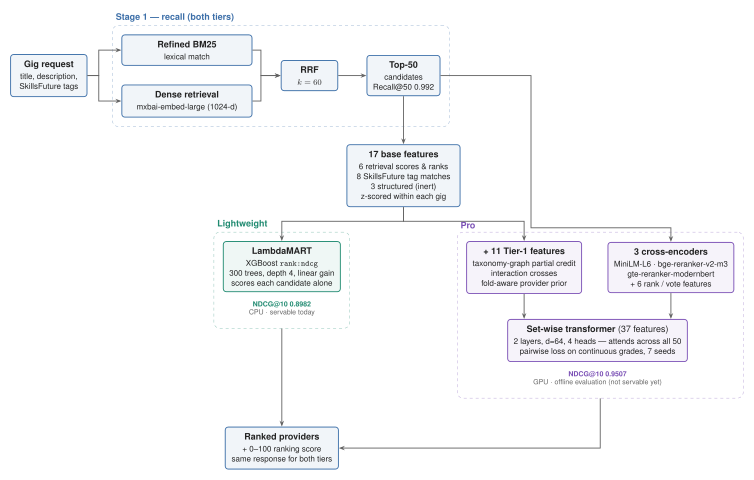
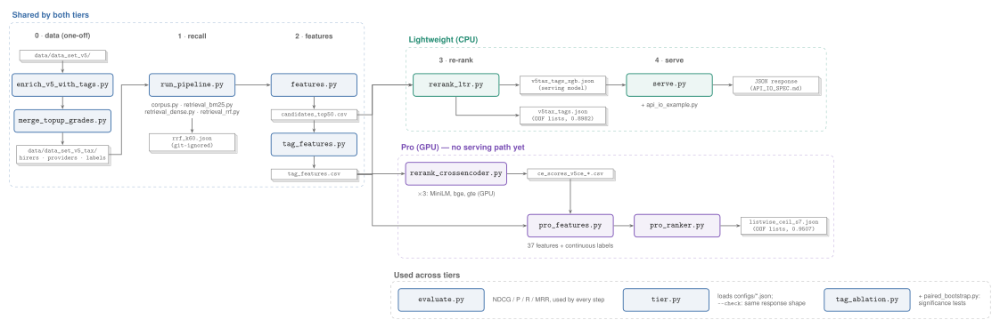

# Senseigigs — gig ↔ provider matching

Given a gig (a hirer's request), return the providers best suited to do it, ranked, with a
0–100 ranking score. The corpus is 1,106 gigs × 3,024 provider showcases, and relevance comes
from 24,070 LLM-graded gig–provider pairs (see [Data](#data)).

Matching is done in two stages. **Stage 1 (recall)** narrows 3,024 providers to a shortlist of
50 with two text retrievers fused together. **Stage 2 (re-ranking)** orders that shortlist —
and this is where the two tiers differ.

## Architecture



## Lightweight and Pro

Both tiers share Stage 1, the 17 base features and the response contract; a client switches
tier by changing one config value. They differ only in the Stage-2 re-ranker:

| | **Lightweight** | **Pro** |
|---|---|---|
| Stage 2 re-ranker | LambdaMART (XGBoost), one candidate at a time | Set-wise transformer over the whole shortlist, fed by 3 fine-tuned cross-encoders |
| Features per candidate | 17 | 37 |
| **NDCG@10** | **0.8982** | **0.9507** |
| P@5 / P@10 | 0.8991 / 0.8304 | 0.9544 / 0.8898 |
| R@10 / MRR | 0.6449 / 0.9774 | 0.6982 / 0.9937 |
| Hardware | CPU | GPU (cross-encoders) |
| Servable today | **yes** — `serve.py --tier lightweight` | **no** — offline evaluation only (see [Serving](#serving)) |
| Config | `configs/lightweight.json` | `configs/pro.json` |
| Artifact | `models_data/data_set_v5_tax/v5tax_tags_xgb.json` | `results_data/data_set_v5_tax/listwise_ceil_s7.json` (OOF lists) |

- **Lightweight** is the practical default: one XGBoost file, runs on a CPU, and has a live
  serving path today.
- **Pro** is the accuracy ceiling: it adds three cross-encoders that read the gig and provider
  text together, and a transformer that compares all 50 candidates at once. It beats
  Lightweight by **+0.0525 NDCG@10 [+0.0476, +0.0573]** (paired bootstrap, 10k resamples) and
  is better on every metric with a CI excluding 0, but needs a GPU and has no serving path yet.

All numbers are out-of-fold over all 1,106 gigs — see [Evaluation](#evaluation).

## Stages

In the order of the diagram above.

### Stage 1 — recall (shared)

Two retrievers run over all 3,024 providers and are fused, so the re-ranker only has to order a
shortlist of 50.

- **Refined BM25** (`retrieval_bm25.py`) — lexical match on the gig title + description against
  each provider showcase, with a synonym table (`data/synonyms.json`). Catches exact skill and
  domain terms.
- **Dense** (`retrieval_dense.py`) — `mixedbread-ai/mxbai-embed-large-v1` (1024-d) embeddings,
  cosine similarity, with a domain query prefix. Catches paraphrases BM25 misses.
- **Reciprocal Rank Fusion** (`retrieval_rrf.py`) — `1/(60 + rank_bm25) + 1/(60 + rank_dense)`.
  Fusing ranks rather than raw scores avoids calibrating two different score scales.
  **Recall@50 = 0.992**: almost every relevant provider makes the shortlist, so Stage 2 is
  purely an ordering problem.

### Base features (shared, 17 per candidate)

| Group | n | Features |
|---|---|---|
| Retrieval | 6 | `bm25_score`, `bm25_rank`, `dense_cosine`, `dense_rank`, `rrf_score`, `rrf_rank` |
| Structured | 3 | `budget_fit`, `seniority_fit`, `avail_immediacy` — **inert** (see [Caveats](#caveats)) |
| SkillsFuture tags | 8 | `tag_level`, `has_tags_gig`, `has_tags_prov`, `cat_any`, `spec_cov`, `skill_cov`, `skill_idf_cov`, `skill_soft` |

The tag features (`tag_features.py`) compare the gig's and the provider's `sf_v1` tags at each
level of the hierarchy — category → specialisation → skill. `tag_level` is the deepest level
they share (0–3); the `*_cov` features are the share of the gig's categories / specialisations /
skills the provider covers (`skill_idf_cov` weights rare skills higher); `skill_soft` is an
embedding similarity of the skill names, for near-synonyms exact matching misses. `has_tags_*`
let the model tell "untagged" from "mismatched".

Score features (`bm25_score`, `dense_cosine`, `rrf_score` and the structured scores) are
**z-scored within each gig**, so the model learns relative standing in the shortlist rather
than raw scales that vary from gig to gig.

### Stage 2, Lightweight — LambdaMART

`rerank_ltr.py`. XGBoost `rank:ndcg` (LambdaMART): 300 trees, depth 4, learning rate 0.05,
**linear gain** (grade 0/1/2/3 → 0/33/67/100, matching `evaluate.py`). It scores each candidate
independently from its 17 features and sorts. The per-gig score is min-max scaled to 0–100 for
the response (rank 1 is always 100 — it is a ranking score, not a probability).

Most of its lift over RRF comes from the tags: on the original labels they add **+0.0188
NDCG@10 [+0.0145, +0.0231]** over the 9-feature model without them (positive on all 3 fold
splits). Biggest by gain importance: `rrf_rank`, `rrf_score`, `tag_level`.

### Stage 2, Pro — cross-encoders + set-wise transformer

A per-candidate tree cannot see the rest of the shortlist, but NDCG@10 is a *list* metric. Pro
replaces it with two additions.

**1. Three fine-tuned cross-encoders** (`rerank_crossencoder.py`). A cross-encoder reads the gig
and the provider text *together* through one transformer, so it can judge fit at the sentence
level instead of comparing two separate embeddings. Fine-tuned on our grades under per-query
k-fold CV, so every score is out-of-fold:

| Cross-encoder | Base model | Alone, NDCG@10 |
|---|---|---|
| `v5ce_minilm` | `cross-encoder/ms-marco-MiniLM-L6-v2` | 0.7706 |
| `v5ce_bge` | `BAAI/bge-reranker-v2-m3` | 0.7696 |
| `v5ce_gte` | `Alibaba-NLP/gte-reranker-modernbert-base` | 0.7923 |

Alone, each is far *worse* than Lightweight, and adding a CE score as a LambdaMART feature
hurt (0.8781 → 0.7966). But their errors are decorrelated from the retrieval/tag signal and
from each other, which makes them strong *inputs* to a model that can decide per gig how much
to trust each.

**2. Set-wise transformer** (`pro_ranker.py`, features from `pro_features.py`). Each
candidate is a 37-feature vector:

| Feature family | n | What |
|---|---|---|
| Base | 17 | the shared features above |
| Tier-1 | 11 | taxonomy-graph partial credit (sibling skill under the same specialisation, skill under the same category, graph distance, Jaccard), interaction crosses (`tl_x_rank`, `speccov_x_tl`, `skillcov_x_tl`), fold-aware provider prior — built in `pro_features.py` |
| Cross-encoder scores | 3 | OOF score from each CE |
| CE consensus | 6 | per-gig rank of each CE score, top-10 / top-20 votes, mean rank |

Model, per candidate: `Linear(37→64) → GELU → dropout 0.1 → 2 × TransformerEncoderLayer (d=64,
4 heads, norm-first) → Linear(64→1)`. Self-attention runs **across the 50 candidates of one
gig**, so it can learn *relative* judgements ("best fit for this gig") that a per-row model
cannot. Features are standardised within each gig.

Loss: pairwise logistic weighted by `|gain_i − gain_j|`, on the grader's **continuous 0–100
score** (`llm_scores_v5.json`) rather than the 4 coarse bins. Training:
GroupKFold by gig, 80 epochs, AdamW lr 1e-3, cosine schedule, grad-clip 1.0, 32 gigs per batch,
**7 seeds averaged** per fold.

How Pro got from Lightweight to 0.9507 (all OOF, all 1,106 gigs):

| Step | NDCG@10 |
|---|---|
| RRF k=60 (Stage 1 only) | 0.8757 |
| Lightweight — LambdaMART, 17 features | 0.8982 |
| Set-wise transformer, no cross-encoder | 0.9019 |
| + MiniLM CE score | 0.9303 |
| + bge-reranker-v2-m3 score | 0.9417 |
| + gte-reranker-modernbert score | 0.9454 |
| + CE rank / vote features | 0.9500 |
| + 7 seeds / 80 epochs | **0.9507** |

Rejected along the way: ListNet loss (0.8381), LambdaRank-discount loss (0.9447), a fourth
cross-encoder (0.9506), live budget/availability/seniority features (0.9508, flat).

## Serving

Both tiers emit the **same request/response shape**, so a client switches tier by changing one
config value. `pipeline/serving/tier.py --check` asserts the two configs agree.

```bash
# from the repo root
python -m pipeline.serving.serve --tier lightweight --hire-id 1 --top-k 10   # live: retrieval → features → model
python -m pipeline.serving.serve --tier lightweight --gig-json request.json  # any gig, including a new one
python -m pipeline.serving.serve --tier pro --hire-id 1                      # exits with the blocking reason
python -m pipeline.serving.tier --check
```

**Pro is not servable yet.** `pro_ranker.py` writes out-of-fold ranked lists only (it
never saves a model), and its cross-encoder inputs are precomputed OOF CSVs, not a live scorer.
Serving it needs: (1) fit the set-wise model on all gigs and save it, (2) run the three
cross-encoders live over the 50-candidate pool (GPU), (3) reuse `serve.py`'s response builder.

The full request/response contract, normalisation and ID-mapping requirements are in
[`API_IO_SPEC.md`](API_IO_SPEC.md); a live example is in [`example_io.json`](example_io.json).

## Data

- **`pipeline/data/data_set_v5`** — 1,106 gigs × 3,024 provider showcases (synthetic), with
  **24,070 LLM-graded pairs** (0–3, `qwen3.8:27b`, temperature 0, prompt `rubric_01.v5`).
  Includes the continuous grader scores (`llm_scores_v5.json`) and the 2,374 top-up grades
  (`judgments_topup_tags.jsonl`, see [Why the tags help](#why-the-tags-help)).
- **`pipeline/data/data_set_v5_tax`** — the same corpus with the SkillsFuture `sf_v1` tags
  attached (`enrich_v5_with_tags.py`; identical text, so identical Stage-1 rankings). Both tiers
  read this one; the cross-encoders train on the v5 copy.

## Evaluation

- **Out-of-fold.** 5-fold GroupKFold **by gig**: every gig is scored by a model that never saw
  any of its pairs. The saved Lightweight model is a separate fit on all gigs, for serving.
- **Metrics** (`evaluate.py`): NDCG@K with linear gain (0/33/67/100), P@K and R@K with
  relevant = grade ≥ 2, MRR. Ungraded pairs count as grade 0.
- **Significance.** Paired bootstrap over gigs (10k resamples); noise floor at 1,106 gigs is
  **≈ 0.007 NDCG@10**. Claims are checked on 3 fold splits.

| System | Artifact (`results_data/data_set_v5_tax/`) | NDCG@10 | NDCG@5 | P@5 | P@10 | R@10 | MRR |
|---|---|---|---|---|---|---|---|
| Stage 1 — RRF k=60 | — | 0.8757 | 0.8817 | 0.8745 | 0.8039 | 0.6197 | 0.9698 |
| LambdaMART, 9 features, no tags (trained on original labels) | `v5tax_lin_orig.json` | 0.8766 | 0.8840 | 0.8750 | 0.8037 | 0.6218 | 0.9714 |
| LambdaMART + tags (trained on original labels) | `v5tax_tags_orig.json` | 0.8954 | 0.9002 | 0.8967 | 0.8288 | 0.6432 | 0.9770 |
| **Lightweight** | `v5tax_tags.json` | **0.8982** | 0.9018 | 0.8991 | 0.8304 | 0.6449 | 0.9774 |
| **Pro** | `listwise_ceil_s7.json` | **0.9507** | 0.9544 | 0.9544 | 0.8898 | 0.6982 | 0.9937 |

All rows are scored against the full 24,070-pair label set. The two "original labels" rows are
the clean tags-vs-no-tags comparison (`tag_ablation.py`):

| Metric | Δ (tags − no tags) | 95% CI |
|---|---|---|
| NDCG@10 | **+0.0188** | [+0.0145, +0.0231] |
| P@5 | **+0.0217** | [+0.0150, +0.0286] |
| R@10 | **+0.0215** | [+0.0153, +0.0278] |
| MRR | +0.0055 | [−0.0001, +0.0115] — crosses 0 |

Pro vs Lightweight: NDCG@10 **+0.0525** [+0.0476, +0.0573], NDCG@5 +0.0527, P@5 +0.0553,
P@10 +0.0594, R@10 +0.0533, MRR +0.0163 — every CI excludes 0. The same Pro configuration
scores 0.9495 and 0.9499 on two reshuffled fold partitions.

Full history of variants tried, including rejected ones: [`ablation.md`](ablation.md).

### Why the tags help

- **They carry signal the text retrievers miss.** Bucket candidates by tag match (none → shared
  category → shared specialisation → shared specialisation *and* skill): at RRF ranks 31–50 the
  share graded ≥ 2 climbs 27% → 37% → 52% → 74%. Controlling for RRF rank, match level still
  correlates with grade (Spearman +0.25).
- **The original labels could not see it.** The judging pool came from the text retrievers' top
  results, so providers they ranked low were rarely graded — and an ungraded pair scores as 0.
  The tag ranker promotes exactly those providers: 13% of its top-10 was ungraded, which first
  read as a −0.04 NDCG@10 regression.
- **So we graded them.** The 2,383 ungraded pairs any tag variant put in its top-10 were graded
  with the same model and prompt (a 60-pair re-grade of already-graded pairs reproduced 60/60
  exactly; 9 failed on malformed replies). 67% came back grade ≥ 2. Merged by
  `merge_topup_grades.py`; both systems' top-10s are now ~99% graded.
- **Exact matching suits the hierarchy.** Category (37 values) and specialisation (144) are a
  closed vocabulary; skills (825) are not, so `skill_soft` adds a soft tier. Industry is left
  out: a provider's industry is always one of its tag categories.

## Layout



Run every script from the repo root as a module, e.g. `python -m pipeline.lightweight.rerank_ltr`.
Data paths resolve against `pipeline/` (`common/paths.py`), so `--data-dir data/<corpus>` works
from anywhere.

```
pipeline/
├── common/        corpus.py · evaluate.py · paths.py
├── data_prep/     enrich_v5_with_tags.py · merge_topup_grades.py
├── recall/        run_pipeline.py · retrieval_bm25.py · retrieval_dense.py · retrieval_rrf.py
├── features/      features.py · tag_features.py
├── lightweight/   rerank_ltr.py
├── pro/           rerank_crossencoder.py · pro_features.py · pro_ranker.py
├── serving/       serve.py · tier.py · api_io_example.py
├── evaluation/    tag_ablation.py · paired_bootstrap.py
└── data/ · features_data/ · models_data/ · results_data/ · cache_data/
```

| Folder / file | Tier | What |
|---|---|---|
| `configs/lightweight.json`, `configs/pro.json` | both | Tier definitions: model, retrieval settings, feature order, headline numbers |
| `pipeline/common/` | both | `corpus.py` (record → text / BM25 tokens), `evaluate.py` (P@K, R@K, NDCG@K, MRR), `paths.py` (where the data lives) |
| `pipeline/data_prep/` | both | One-off: `enrich_v5_with_tags.py` builds `data_set_v5_tax` from `data_set_v5` + the mcjuh `sf_v1` tags; `merge_topup_grades.py` folds the top-up grades into the label files (idempotent) |
| `pipeline/recall/` | both | Stage 1: `retrieval_bm25.py`, `retrieval_dense.py`, `retrieval_rrf.py`, driven by `run_pipeline.py` |
| `pipeline/features/` | both | `features.py` → `candidates_top50.csv` (top-50 pool + retrieval/structured features + labels); `tag_features.py` → `tag_features.csv` (8 tag features; own process — torch) |
| `pipeline/lightweight/` | Lightweight | `rerank_ltr.py`: LambdaMART training + OOF evaluation → `v5tax_tags_xgb.json`, `v5tax_tags.json` |
| `pipeline/pro/` | Pro | `rerank_crossencoder.py` (cross-encoder OOF fine-tune → `ce_scores_v5ce_*.csv`), `pro_features.py` (the 37 features + continuous labels), `pro_ranker.py` (set-wise transformer → `listwise_ceil_s7.json`) |
| `pipeline/serving/` | Lightweight (Pro planned) | `serve.py` (live path), `tier.py` (loads a config; `--check` keeps both tiers' responses aligned), `api_io_example.py` (I/O example generator) |
| `pipeline/evaluation/` | evidence | `tag_ablation.py` (tags-vs-no-tags significance test) and `paired_bootstrap.py` |
| `pipeline/data/` | both | Corpus and labels (see [Data](#data)) |
| `pipeline/features_data/`, `models_data/`, `results_data/` | — | Feature tables, trained models, out-of-fold ranked lists. Only tier artifacts and the lists behind the significance tests are kept; earlier experiment outputs and scripts are in git history (tag `pre-cleanup`) |
| `figures/` | — | `architecture` and `code_flow` diagrams: TikZ source (`.tex`) + `.pdf` / `.svg` / `.png`; rebuild with `figures/build.sh` |

## Reproduce

```bash
pip install -r pipeline/requirements.txt                                  # Lightweight
pip install -r pipeline/requirements.txt -r pipeline/requirements-pro.txt  # Pro
# every command below runs from the repo root
```

**Shared — Stage 1, features, labels**

```bash
python -m pipeline.recall.run_pipeline          --data-dir data/data_set_v5_tax
python -m pipeline.features.features            --data-dir data/data_set_v5_tax
python -m pipeline.data_prep.merge_topup_grades --data-dir data/data_set_v5_tax   # no-op on the committed files
# own process: torch + xgboost in one process segfaults on macOS
python -m pipeline.features.tag_features        --data-dir data/data_set_v5_tax
```

**Lightweight** (CPU, minutes)

```bash
# OOF lists -> results_data/data_set_v5_tax/v5tax_tags.json
# full-data model -> models_data/data_set_v5_tax/v5tax_tags_xgb.json
python -m pipeline.lightweight.rerank_ltr    # defaults = shipped config (17 features, linear gain, per-gig z-scores)
python -m pipeline.evaluation.tag_ablation   # the significance test
```

**Pro** (GPU; ~20–60 min per cross-encoder on an H100)

```bash
# 1) cross-encoder OOF scores
python -m pipeline.pro.rerank_crossencoder --mode finetune --data-dir data/data_set_v5 \
    --model cross-encoder/ms-marco-MiniLM-L6-v2 --tag v5ce_minilm --epochs 3 --cv-folds 5
python -m pipeline.pro.rerank_crossencoder --mode finetune --data-dir data/data_set_v5 \
    --model BAAI/bge-reranker-v2-m3 --tag v5ce_bge --epochs 2 --cv-folds 3 --max-length 512
python -m pipeline.pro.rerank_crossencoder --mode finetune --data-dir data/data_set_v5 \
    --model Alibaba-NLP/gte-reranker-modernbert-base --tag v5ce_gte --epochs 2 --cv-folds 3 --max-length 768

# 2) set-wise ranker -> results_data/data_set_v5_tax/listwise_ceil_s7.json
python -m pipeline.pro.pro_ranker      # defaults = shipped config (3 CEs, d=64, 2 layers, dropout 0.10, 7 seeds, 80 epochs)
```

Stage-1 ranked lists, the embedding cache and the skill-vector cache are git-ignored and
regenerate from the commands above.

## Caveats

- **The labels are LLM grades of text relevance, not hirer outcomes.** One model at temperature
  0, on text only — the grader never saw the tags or structured fields, so those features cannot
  be "agreeing with themselves", but they also cannot lift a metric defined on text relevance.
- **Budget, availability and seniority do not affect either tier.** `seniority_fit` is dead
  (providers have no `seniority` field). `budget_fit` and `avail_immediacy` are now supported by
  the data, but the shipped Lightweight model was trained when they were zeros and `serve.py`
  sends zeros; training on live values is flat (Pro 0.9508 vs 0.9507). Use them as filters or a
  business re-weighting after ranking, or re-grade with constraint-aware relevance.
- **Retraining Lightweight today gives ~0.8974, not 0.8982.** `candidates_top50.csv` now holds
  live budget/availability values, and `avail_immediacy` anchors "available now" to
  `date.today()`, so it drifts daily. The committed model and results are the 0.8982 run. For
  the same reason, re-running `tag_ablation.py` today gives the tags **+0.0170 NDCG@10
  [+0.0127, +0.0214]** instead of the +0.0188 above — smaller, still clearly significant.
- **The top-up grades were chosen by the tag rankers.** They cover every ungraded pair in the
  tag variants' top-10s, so they cannot favour the baseline; on other fold splits a few ungraded
  pairs remain (top-10 still ~99% graded). Even scoring every remaining ungraded pair against
  the tags, they keep +0.0122 NDCG@10 [+0.0080, +0.0165].
- **Compare rows only within one label set.** The top-up grades raised the ideal DCG for some
  gigs, so every system's NDCG@10 is a little lower on the 24,070-pair set (RRF 0.8861 → 0.8757).
- **Pro hyperparameters were selected on the GroupKFold split**; the same configuration scores
  0.9495 / 0.9499 on two other partitions, so the ~0.95 is not a lucky split.
- **BM25 counts the gig title 4×, not the documented 3×** (`hirer_text()` already contains the
  title and `hirer_bm25_tokens()` adds it 3 more times). It affects every system equally; fixing
  it would move every Stage-1 number, so it is flagged rather than changed.
- **Untagged records**: 87 gigs and 252 providers have no tags; they fall back to
  retrieval-only ordering.
- **`--max-length` on the cross-encoder**: the bge/gte default is 8192 tokens; pairs run to ~764
  (p90 595), so 512–768 is the practical cap.
